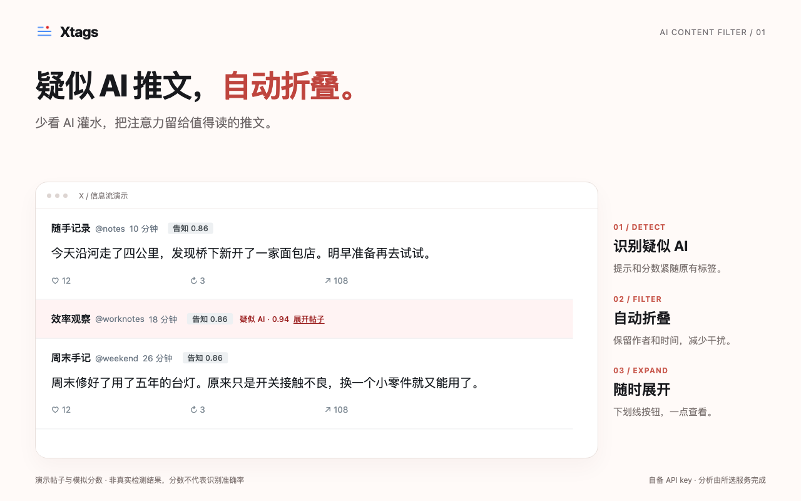

# Xtags

[English](README.en.md) | 简体中文

**识别 X 推文中的疑似 AI 内容，自动折叠，减少阅读干扰。**

少看 AI 灌水，把注意力留给值得读的推文。Xtags 在原有标签后显示疑似 AI 提示和模型分数；达到你设置的阈值后，自动折叠正文、媒体和互动区域，保留作者与时间。点击无框、下划线样式的“展开帖子”即可查看。



*使用当前扩展代码渲染的演示帖子，分数为模拟数据，不是真实检测结果或识别准确率。*

- **识别与过滤**：自动折叠、仅微红提示、仅标签，三种模式可选；AI 默认阈值 0.85，可独立调整。
- **随时展开**：展开后保留淡红提示；本标签页记住展开选择，详情页默认展开。
- **长文提前判断**：在手动展开前，分析 X 页面数据中已经提供的全文；全文不可用时等待，不将摘要当成全文。
- **辅助理解意图**：保留告知、说服、挑拨、推销、娱乐、其他六类意图，以及诱导愤怒和未披露推广提示。

需要 Chrome 140+、网络及所选服务的 API key，服务商可能收费。默认使用 TypeSafe 的 [Jev](https://docs.typesafe.ai/)；支持兼容的自定义 HTTPS API。明确同意后，正文及作者账号会发送给所选服务，分析并非设备端完成。AI 判断可能出错，不能证明文本来源。

---

## ⚠️ 使用范围与免责声明

**本工具仅供个人本地浏览辅助使用。** 它在你自己的浏览器里，读取你正在浏览的页面。

本项目独立开发，与 X Corp 无任何关联，未获其授权或认可：

> This project is independent and not affiliated with, authorized, or endorsed by X Corp.

**分类结果由 AI 模型生成，可能存在误差，不代表作者立场。** 标签是对帖子文本的一种概率判断，不是事实陈述，也不构成对任何账号、观点或事件的评价。请勿将标签作为事实依据。

**你需要自行确认这种用法在你所在司法辖区和你的使用场景下是否合规。** X 的服务条款禁止通过其官方接口以外的方式自动化访问其服务。本项目只读取你自己浏览器里已经渲染出来的内容，不绕过任何技术限制，但这不表示它自动合规。

**本项目按「原样」提供，不附带任何形式的明示或暗示担保**，包括但不限于对适销性、特定用途适用性及不侵权的担保。在任何情况下，作者均不对因使用本软件而产生的任何索赔、损害或其他责任负责。完整条款见 [LICENSE](LICENSE)。

---

## 安装

### 加载已解压的 Chrome 扩展

```bash
git clone <this-repo> && cd xtags
```

1. Chrome 打开 `chrome://extensions`
2. 右上角开启**开发者模式**
3. 点**加载已解压的扩展程序**，选 `extension/` 目录
4. 点工具栏上的图标，点击**设置**，阅读数据上传说明和隐私政策，勾选同意项并点击**同意并启用**。
5. 填入所选服务的 API key。默认使用 TypeSafe（在 <https://console.typesafe.ai/settings/keys> 获取）；如需第三方服务，先按[配置说明](API_SERVICES.md)保存兼容的 HTTPS API URL，再同意向该地址传输数据。

## 界面语言

默认选择“自动（跟随系统）”：以 Chrome 的界面语言为准，中文环境使用简体中文，其他语言环境使用英文。在扩展弹窗的“语言”菜单中，也可以手动选择 `中文` 或 `English`，或切回自动。

选择会保存在本地，并立即同步到已打开的 X 页面。帖子标签、悬浮说明、状态面板和扩展自身的错误提示都会切换语言；已有概率缓存和进行中的判断保持不变，不会因切换语言重新调用 API。Chrome 扩展管理页中的描述由浏览器语言控制。

---

## 它做什么

每条帖子在一次请求中判断四个维度：

| 判断 | 形态 | 回答什么 |
| --- | --- | --- |
| `intent` | choice | 这条帖子主要在干什么：告知 / 说服 / 挑拨 / 推销 / 娱乐 / 其他 |
| `rage_bait` | noul | 是不是在靠激起愤怒换互动 |
| `synthetic` | noul | 是否疑似主要由 AI 撰写或大幅改写 |
| `undisclosed_ad` | noul | 有没有把商业推荐包装成独立意见且未见披露 |

**意图每条都显示**；诱导愤怒、未披露推广按信号阈值显示。**疑似 AI 使用独立阈值**，默认 0.85；达到阈值后，列表中保留作者与时间，折叠正文、媒体和互动区域，在原有标签后显示 AI 概率及无框下划线样式的“展开帖子”按钮，不单独占一行。

点击展开后保留微红底色，可再次收起；本标签页记住手动展开的帖子，滚动离开再回来不会重新折叠。详情页默认展开。popup 和设置页可选“自动折叠 / 仅微红提示 / 仅标签”，AI 阈值在设置页调整；这些改动复用已有判断，不额外请求 API。

AI 判断仅估计主要撰写或大幅改写，简单纠错、排版不算。短帖照常判断，长帖使用全文；工整、套话、列点、具体细节或错别字都不能单独证明来源。标签不是作者来源证明，也不代表虚假或恶意。0.85 为初始展示阈值，尚未经真实样本校准。0.2.1 将旧的“模板化文案”问题改为 AI 生成估计，因此旧缓存会失效。

0.1.8 收紧了判断边界：激烈批评或未附证据本身不算诱导愤怒；单条短文的工整措辞不足以判断机器生成；未披露推广只根据可见文案估计，不推断真实收款或合作关系。旧版判断缓存会失效，再浏览相同帖子可能产生新的 API 请求。

折叠的长推文会在首次分类前使用 X 页面数据中已有的全文，不必先点击“显示更多”。如果暂时无法取得全文，会显示“全文暂不可用”，不会把可见摘要误当成整篇来判断；扩展会自动重试三次，之后在页面变化或展开时再尝试。更新后需要在设置页重新同意这一数据传输，旧的摘要判断缓存会失效。

### 颜色不是随手配的

颜色辅助区分意图和风险。AI 来源估计独立展示：

| 标签 | 颜色 | |
| --- | --- | --- |
| 告知 | 中性灰 | 低段三种是**平级**的 |
| 娱乐 | 绿 | 颜色只区分种类， |
| 其他 | 青绿 | 不表示谁更严重 |
| 说服 | 蓝 | ↓ 从这里往上 |
| 推销 | 琥珀 | 颜色**同时**表示严重度 |
| 疑似 AI | 紫 | 独立维度，不表示虚假或恶意；微红底色用于提醒 |
| 未披露推广 | 橙 | |
| 挑拨 / 诱导愤怒 | 红 | |

八种颜色已经接近人眼能排序的上限，所以**真正承载信息的是文字，颜色是辅助**——色觉不同或截图转成灰度，读到的信息不该变。橙、红两档另外加了字重就是这个道理。

---

## 怎么工作

```
fulltext.js (页面上下文)   从折叠长文的 X 页面数据中读取全文
     ↓ 页面 DOM 事件
content.js   读 DOM、提取帖子、按当前阈值渲染标签
     ↓ chrome.runtime.sendMessage
background.js (service worker)  请求队列、去重、持久化缓存
     ↓ fetch
api.typesafe.ai
```

**为什么请求必须走 service worker**：MV3 的内容脚本虽然跑在隔离世界，但网络请求仍用页面的源，因此受 CORS 约束。TypeSafe 的 API 不会给 `x.com` 发 `Access-Control-Allow-Origin`，内容脚本里直接 `fetch` 必然被拦，而且报错被抹成一句没用的 `Failed to fetch`。service worker 有 `host_permissions`，不受这个限制。

其他几个设计点：

- **后台按 status ID 和正文指纹缓存、去重**。同一帖子正文变化后会重新判断，多个标签页可共享相同正文的结果；全局最多 3 个并发请求。返回结果先按白名单重建，缓存不保存正文原文或额外调试字段；最多 3,000 条、2 MiB，按条增量写入。标签记录所属 status ID，虚拟列表复用节点时会检查并更新。
- **改阈值不重新请求**。缓存保存原始概率，每次渲染都按当前阈值组合标签，刷新页面也保持一致。支持 0–1 的阈值。
- **暂停会停止队列并取消在途请求**。清缓存、换模型或 key 后，旧请求结果不能写回；已经发送到服务端的请求无法保证撤回或免除费用。
- **失败恢复有边界**。每次请求超时 20 秒；网络故障、429 和 5xx 最多尝试 3 次，401 等错误不自动重试。后台尝试耗尽后，暂时性失败可在 15 秒、60 秒后各恢复一轮（每轮后台最多 3 次，共最多 9 次）；网络恢复可提前触发剩余的一轮。认证、权限、格式错误不自动恢复。popup 显示最近请求状态，并提供“重试失败的帖子”；修正 key 或正文变化也可重试。暂停会取消恢复计时器。
- **队列随帖子更新**。正文和作者来自同一主帖，不借用引用卡片的正文。页面队列最多 100 条；发送前复查节点、正文和回复设置，失效任务会通知后台取消；其他标签页仍需要的共享请求保留。
- **清缓存同时暂停**。在设置页点击“暂停并清空缓存”，等待清理完成；key 保留，手动重新启用后才会再次分析。保存 key、阈值等配置失败时，控件恢复已保存值并显示提示。
- **标签适配页面深浅色**。支持键盘聚焦、Enter/空格及点击查看说明，Escape 关闭；主意图和概率保持常显。
- **面板不驱动扫描**。只处理页面本身的变化，插件标签和 HUD 的更新不会触发循环。
- **回复用文本前缀识别**，不用 `data-testid`。因为 action bar 里那个「回复」按钮的 testid 恰好也叫 `reply`，按 testid 匹配会把每一条帖子都当成回复。
- **缓存带版本号**。字段或判断标准改变时会重建旧缓存，避免继续显示旧提示词的结果。

---

## 隐私

- **页面文本会发送到所选 API 服务（默认 TypeSafe）** 做判断——这是它工作的必要部分。发送的是帖子正文和作者 handle；折叠长推文会发送 X 页面数据中已有的全文，即使你尚未点击展开。
- **API key 存在浏览器本地**（`chrome.storage.local`），不会同步到任何账号；只在请求当前所选 API 服务时作为认证凭证发送。持久存储仅供扩展可信页面和后台读取；X 页面内容脚本只接收脱敏设置和“已配置 key”的布尔状态。此访问限制要求 Chrome 140 或更新版本。注意 key **未加密**，以你的用户身份运行的进程仍可能读到。
- **没有开发者分析、遥测或分类服务器**。所选 API 服务会接收请求正文、作者账号和 IP 等连接信息；本地持久化缓存含帖子 ID、正文指纹、判断结果和时间戳，不保存正文原文。统计数字只在当前标签页内存中保留；最近 API 请求状态以受控错误码、HTTP 状态和时间保存在临时 session 存储，不保留错误正文；费用为该页实际请求的估算，不含其他标签页和失败请求可能产生的费用。完整说明见[隐私政策发布稿](docs/privacy.zh-CN.html)。

---

## 开发与验证

需要 Node.js 20+；浏览器回归还需要本机 Chrome 或 Chromium，无须安装 npm 依赖。

```bash
npm test                 # 后台队列、并发、缓存、超时和配置竞态
npm run test:browser     # 真实 DOM / MutationObserver 回归
```

非默认安装路径可通过 `CHROME_BIN` 指定浏览器可执行文件。测试使用独立临时浏览器配置和模拟 API，不使用真实 key，不产生 API 费用；不能替代真实 X 页面的端到端验证。

0.1.1 使用新的原始概率缓存格式，升级后旧缓存会自动失效，首次浏览时重新判断帖子。

---

## Chrome Web Store 提交准备

**0.2.1 为商城候选版，已更新 AI 识别与过滤素材并打包，尚未发布。公开 Pages 已按本次授权仅同步 docs 页面并核对。源码及商店资料对应 0.2.1；商店后台已保存候选包与素材，尚未提审。**

商店文案、图片、权限申报、审核说明和发布检查见 [store/README.md](store/README.md)，本版变更见 [0.2.1 更新说明](store/RELEASE_NOTES_0.2.1.md)。[英文隐私政策](https://manifoldor.github.io/xtags/privacy.html)、[中文隐私政策](https://manifoldor.github.io/xtags/privacy.zh-CN.html)和[支持页](https://manifoldor.github.io/xtags/support.html)由 `main` 分支的 `docs/` 发布。扩展运行包可通过 `python3 scripts/package-store.py` 重建；提交前仍需完成真实环境验证并在商城私有字段提供审核访问说明。

## 许可

[MIT](LICENSE) © 2026 yishan

按「原样」提供，不附带任何担保。

0.1.3 增加数据上传说明、未预选的同意入口及撤回按钮。新装和旧版升级均须明确同意后才会分类；中英文隐私政策随扩展打包，无需等待网站上线即可阅读。

0.1.4 将数据上传说明、同意/撤回、API key、缓存清理和版本信息集中到独立设置页。点击 popup 的“设置”，或从 Chrome 扩展管理页打开“扩展程序选项”。popup 保留语言、启停、阈值和显示开关；页面间设置即时同步。

0.1.5 增加自定义 API URL：默认官方 TypeSafe，可在设置页切换到兼容的第三方 HTTPS 服务。保存新地址后重新同意并填写该服务的 key。[配置及接口格式](API_SERVICES.md)。

0.1.8 在不改变原有标签结构的前提下优化判断边界；折叠长文在展开前按全文分类，旧同意需重新确认。API key 只向可信扩展上下文开放；旧概率缓存会按新版判断标准重建。需要 Chrome 140 或更新版本。

0.1.9 修复引用正文归属、失效任务继续上传、暂时性错误恢复、响应最小化与错误回显问题；改善深浅色标签、键盘说明和设置反馈。清缓存现在会先暂停处理。

0.2.1（本地候选版）：增加独立 AI 生成倾向、0.85 默认阈值，以及自动折叠、微红提示和仅标签三种模式。未改动模型配置；Jev 1.14 的实际判别效果仍需独立验证。

历史实际意图标签截图：[作者提供的截图](store/assets/screenshot-labels-original.png)。该截图保留为辅助功能示例，不展示新版 AI 折叠。
